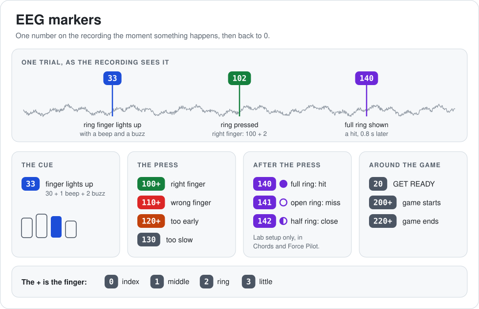

<h1 align="center">EEG lab folder</h1>

Finger Rehab for the EEG lab: the game, its marker settings and a PsychoPy launcher. Copy it to the lab PC without the <code>developer/</code> folder, or use <code>FingerRehab-EEGLab.zip</code> from the release, which doesn't include it.

## Run it

1. On the game PC, plug in the trigger box (COM10) and the hand device first. On a new lab PC, time the screen and the tone against the markers once, with a light sensor and a microphone on the amplifier's spare inputs ([eeg_lab_setup.txt](../app/docs/eeg_lab_setup.txt), Validate).
2. Open `run_in_psychopy.py` in PsychoPy Coder and press **Run**. ActiView's trigger byte goes from 255 to 0 when the port opens. If the box isn't on COM10, a port list appears and after a few seconds the game picks the one port that sends no force stream. Check it's the right one, or pick the marker's port, then press **Continue**.
3. Log in. The menu shows the recording's name, for example `P07_2026-09-24.bdf`: start ActiView recording under exactly that name before the first game. ActiView can run on the game PC or the EEG PC; the trigger box writes every marker into the recording either way. When it runs on the EEG PC, the menu keeps asking for the file in `sessions/eeg`. That's expected, so carry on.
4. On the hub pick **Lab session**, then **Start**. It plays the lab's Reaction task first, in place of both Reaction blocks, and leaves out Muscle Memory. Reaction opens on its setup screen, which should be kept turned away from the participant: pick the timing group, say it aloud, then press **START**. After the recall, ask what they noticed about the order of the lit cards and write the answer down word for word.
5. End the session on the game PC (Esc, **End session**), then stop the recording.
6. Take home the game PC's `sessions` folder and the `.bdf`. Put the `.bdf` in `sessions/eeg` and the notebook will pair each game with its recording by name.

## Markers

While ActiView records, the game writes a number onto the recording the moment something happens, so the brain signal can be cut around each event afterwards.

**Trigger point.** A press marker (100 and up) goes out once the finger's force has been at least 30% of the way from resting to the light press at calibration for two samples in a row (this is the press point, which can be changed in Settings, Setup), and never under 12 sensor counts (about 0.23 N) above rest. It goes out 0 to one frame (17 ms) after that 200 Hz sample. A stimulus marker goes out on the frame that shows the stimulus. Reaction, the lab's own task, sends each press marker at the end of its trial, with the press time as `t_event`.

<picture><source media="(prefers-color-scheme: dark)" srcset="../app/docs/images/eeg_cheat_sheet_dark.svg"></picture>

Reaction, the lab's own task, marks each flash with 30, the number the lab's script used. Every session also saves `markers_codes.csv`, the full list of codes it was recorded with, including the numbers that only some games use.

Timing, for the analysis

The monitor's delay in lighting the picture and the tone's delay are timed once per lab PC with a light sensor and a microphone; until that's done, visual epochs have an unknown fixed offset for each monitor. A press sample reaches the computer in USB bursts about 20 ms apart, so it can itself be up to 20 ms late. `events.tsv` moves every press marker back: `press_offset_ms` to its sample on the board's own clock, `onset_offset_ms` to where the push began on the force trace, a median 50 ms earlier on the October 2026 recordings. Lock response-locked epochs to the onset.

## In this folder

| | |
| --- | --- |
| `run_in_psychopy.py` | Starts the game: the exe on Windows, `source/` anywhere else |
| `Finger Rehab.exe` | The game, from the latest [release](https://github.com/basil2fxs/Hand-Rehab-Thesis/releases/latest) |
| `eeg_lab.yaml` | Lab settings: COM10, 9600 baud, 8 ms pulses and the SRT's response bytes. The games themselves are the same as in every other build |
| `source/` | The game's code, for PsychoPy's own Python |
| `sessions/` | Everything recorded here |
| `developer/` | Set-up tools that aren't needed at the lab: an EEG simulator for rehearsing, the PsychoPy download and a check for a new PC ([README](developer/README.md)) |

`eeg_lab.yaml` and `source/` are copied from the app, so don't edit them here: `python3 app/scripts/check_lab_sync.py --fix` rebuilds them. The full checklist is in [eeg_lab_setup.txt](../app/docs/eeg_lab_setup.txt), and [developer/README.md](developer/README.md) explains how this folder is built and how each marker is made.
