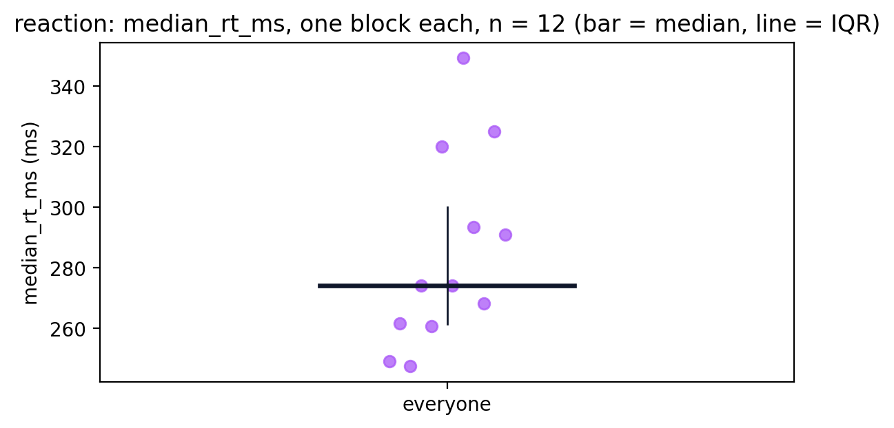
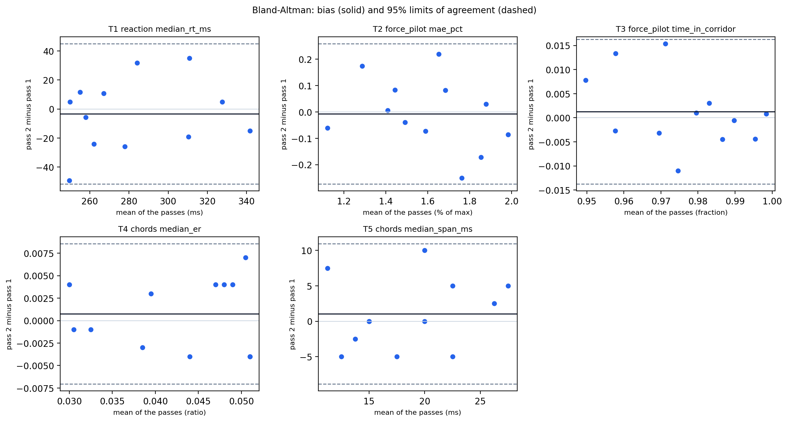

# analysis

Everything that turns session folders into results. The notebook is the general tool and reads any sessions the game wrote. The scripts beside it answer the thesis's narrower questions about the final data, the press detector and the device, and take their session folders on the command line, so no folder name (and so no participant's name) is written into the code. EEG recordings have their own package, [`eeg/`](eeg).

```bash
pip install -r ../app/requirements.txt       # the notebook and the scripts
pip install mne python-picard                # the EEG package as well
```

The scripts import the game's own code from `../app`, so a replay runs the exact rules the game ran. Keep this folder beside `app/`.

## The notebook

[`session_analysis.ipynb`](session_analysis.ipynb): a chapter per game, the cohort tables and figures, an HTML report and the references.

1. Open it in VS Code or Jupyter and run the Setup cell.
2. Pick a save from the dropdown: one game, one session, or one person across every day they played.
3. Run All.

<p align="center"> <br><sub>Two of the cohort chapter's figures, from a simulated cohort.</sub></p>

It finds `sessions/` beside it or up to four levels above; set `SESSIONS_DIR` in the Setup cell for a copy kept elsewhere. Without the dropdown, set `pick` there by hand: `"latest"`, `"all"`, a code like `"P01"`, a day like `"2026-08-05"`, a game like `"adaptive"`, or a list of these, each narrowing the last. Run All on the newest game alone leaves most literature checks with "no data".

The figures, tables and `report.html` go into the newest analysed session folder, under `analysis/`, beside `shared/matlab/finger_rehab.mat` for MATLAB and `shared/rayan_format/` for the bench scripts in [`app/docs/research/rayan`](../app/docs/research/rayan). One person's standing summary goes to `sessions/individual_patient_results/<code>/`, the cohort's to `sessions/cohort_results/`, which prints no test below eight people.

The notebook needs nothing from the repository, so it can be handed to someone on its own. The constants it copies from the game are held to the game by `app/tests/test_notebook_matches_software.py`. Methods and sources: [`app/docs/research/analysis_methods.md`](../app/docs/research/analysis_methods.md).

## The scripts

Run them from this folder. Those that read sessions take `LABEL=BLOCK_FOLDER` pairs, so the output says `L1` rather than a folder name; most write JSON and figures into `--out DIR`, and the simulations print to the terminal (`--json` to save). Each file's docstring says exactly what it reads and writes.

The laboratory's sequence task and the press timing on the real sessions:

| Script | What it answers |
| --- | --- |
| `sequence_task.py` | The task scored the lab's way (correct presses under 1000 ms, each block's first trial dropped): the learning score with its interval, read several ways, a mixed model with each player's own speed and learning, error rates, early presses and recall |
| `press_check.py` | Whether each counted press sits where its push began on the force stream, how steeply it rose, and how late the computer stamped the samples |
| `onset_sensitivity.py`, `onset_accuracy.py` | How much the press check depends on its onset rule, and how close that rule gets to a push's known start |
| `count_lag.py` | How many samples after the raw force crossed the trigger each press was counted |
| `count_rule_replay.py` | The two-raw-sample count of 3 November 2026 replayed against the smoothed count the sessions ran |
| `stuck_pad_replay.py`, `stuck_pad_figure.py` | What the resting-finger rules of 24 October 2026 change, replayed and drawn; the old rules must first reproduce every logged press |
| `hold_replay.py` | What holding the baseline during a push would change (shipped off) |
| `review_report.py` | All of it with the EEG, as a short PDF for the people checking the results |

The detector and the device, simulated:

| Script | What it answers |
| --- | --- |
| `detector_lag_vs_rise.py` | How long after the trigger a press is counted, for pushes rising over 10 ms to 3 s |
| `patient_hand_sim.py` | The detector on weak, slow and shaking presses, and on a resting tremor |
| `startup_sim.py` | The time from opening the port to the first sample, on a board that reproduces the logged start-ups |
| `sensor_agreement_sim.py` | The study's presses read again through simulated uncalibrated pads |
| `mirror_sim.py` | Mirror on two simulated boards, with a known lead and a weaker hand |
| `syllables_sim.py` | Syllables played by a fluent and a struggling simulated reader on each age profile |
| `timing_tools_sim.py` | The sound, motor and screen timing tools reading back delays planted in their signals |
| `adaptive_band.py` | The adaptive controller against its 65 to 80% band, for hands of different speeds |

```bash
python3 sequence_task.py --out DIR LABEL=BLOCK_FOLDER [LABEL=BLOCK_FOLDER ...]
python3 detector_lag_vs_rise.py --out lag.png
```

The thesis's run of the main ones, with the folder names filled in, is `run_all.sh` in the git-ignored [FINAL TRIAL RESULTS](../FINAL%20TRIAL%20RESULTS).

## EEG recordings

[`eeg/`](eeg) analyses a lab session's BioSemi recordings with MNE-Python: it pairs each `.bdf` with its game block by the marker bytes, cleans it (average reference, 0.1 to 40 Hz, ICA for the eyes), checks the markers before reading any effect, and measures the brain responses for Reaction's sequence task and Buzz Hunt.

```bash
python3 -m eeg "../FINAL TRIAL RESULTS/3 EEG lab/sessions"
```

Results go beside the sessions, in `results/<date>_<participant>/`: a short `EEG_report.pdf` and a `detail/` folder with the full results. `--reuse` redraws from the cached run, kept in the system's temporary folder because it holds the recordings. Two recordings or more are read together with `python3 -m eeg.group SESSIONS_1 SESSIONS_2 --out DIR`, which tests each person's own difference between conditions; with two people, that's a statement about those two.

## Tests

The analysis code is tested from the app's suite, mostly without MNE: `test_sequence_task.py`, `test_press_check.py` and the `test_eeg_*.py` files in `app/tests`, and for the notebook `test_rehab_analysis.py`, `test_cohort_notebook.py`, `test_mode_checks_notebook.py` and `test_notebook_matches_software.py`.
