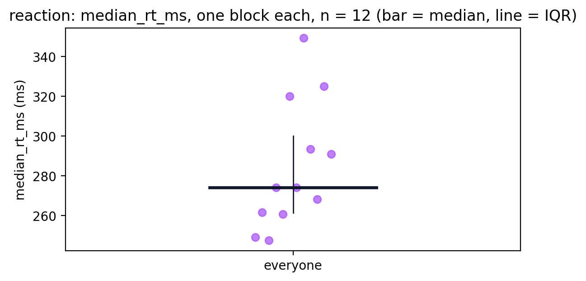
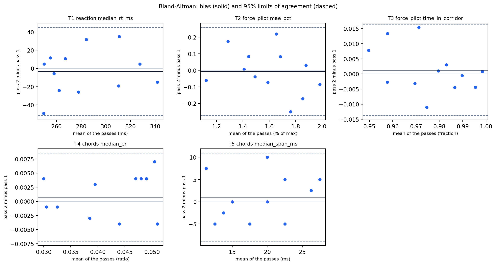

# analysis

Everything that turns session folders into results. The notebook reads any set of sessions the game wrote and is the general tool. The scripts beside it were written for the thesis's final data (the laboratory's sequence task, the press timing and the press detector) and each takes its session folders on the command line, so no folder name, and no participant's name, is written into the code. The EEG recordings have a package of their own, [`eeg/`](eeg).

## Setting up

```bash
pip install -r ../app/requirements.txt       # the notebook and the scripts
pip install mne python-picard                # the EEG package as well
```

The scripts borrow the game's own code from `../app` (the press detector, the adaptive controller, the force-onset rule), so the replay of a session uses exactly the rules the game ran. Keep this folder beside `app/`.

## The notebook

[`session_analysis.ipynb`](session_analysis.ipynb): a chapter per game, the cohort tables and figures, a report, and the reference list.

1. Open it in VS Code or Jupyter and run the Setup cell.
2. Pick a save from the dropdown: one game, one session, or one person across every day they played.
3. Run All.

<p align="center"> <br><sub>Two of the cohort chapter's figures, from a simulated cohort.</sub></p>

It finds `sessions/` beside it or up to four levels above; set `SESSIONS_DIR` in the Setup cell for a copy kept elsewhere. Without the dropdown, `pick` can be set by hand in the Setup cell: `"latest"`, `"all"`, a code such as `"P01"`, a day such as `"2026-08-05"`, a game such as `"adaptive"`, or a list of these, each narrowing the last. A plain Run All reads the newest game only, so most literature checks say "no data" until `pick` covers more.

Where things land:

- The figures, the CSV tables and `report.html` go into the newest analysed session folder, under `analysis/`.
- One person's standing summary goes to `sessions/individual_patient_results/<code>/`, the cohort's tables and report to `sessions/cohort_results/`.
- Next to those, the export cell writes `shared/matlab/finger_rehab.mat` for MATLAB and `shared/rayan_format/`, the layout the force-sensor bench scripts in [`app/docs/research/rayan`](../app/docs/research/rayan) read unchanged.

Everything the notebook needs is in its Setup cell, with no import from the repository, so it can be handed to someone on its own. The constants it copies from the game are checked against the game by `app/tests/test_notebook_matches_software.py`, and the cohort chapter prints no test below eight people (`COHORT_MIN_N`). Methods and their sources: [`app/docs/research/analysis_methods.md`](../app/docs/research/analysis_methods.md).

## The scripts

Run from this folder. `LABEL=BLOCK_FOLDER` pairs name a short label for each session folder, so the output says `L1` rather than a folder name.

| Script | Reads | Writes | What it answers |
| --- | --- | --- | --- |
| `sequence_task.py` | sequence-task blocks, `LABEL=BLOCK_FOLDER` | `DIR/sequence_task.json`, `.png` | The laboratory's serial reaction time task scored as the laboratory scores it: correct presses under 1000 ms, each block's first trial dropped, the learning score as post-test minus block 8 with a bootstrap interval, and again without reversals, without presses made before the flash, and against the faster random block. It also fits a mixed model with each player's own speed and own learning effect, reads the error rates and the presses made too early to be reactions, and scores recall against simulated guessing |
| `press_check.py` | the same blocks | `DIR/press_check.json`, `.png` | Whether each counted press sits where its push began on the board's force stream, block by block, with how steeply each push rose and how late the computer stamped the samples |
| `count_lag.py` | the same blocks | `DIR/count_lag.json` | For the counted press of every flash, how many samples after the raw force crossed the press threshold the detector counted it, replayed under the rules that ran |
| `onset_sensitivity.py` | `KEY=session` pairs | `DIR/onset_sensitivity.json` | How far the press check moves with the onset rule's velocity threshold at 10 and 30% of the peak instead of 18 |
| `stuck_pad_replay.py` | `KEY=session` pairs | the terminal | Which counted presses change under the resting-finger rules added on 24 October 2026; the old rules must reproduce every logged press first, which proves the replay is faithful. `--rest` and `--hold` sweep the two times |
| `stuck_pad_figure.py` | one `KEY=session` | a figure | One player's pad through the blocks where it rested above its release margin |
| `detector_lag_vs_rise.py` | nothing: linear ramps at 200 Hz | a figure with `--out` | How long after the raw crossing a press is counted, for rises of 10 to 1000 ms at three peaks; from about 0.8 s no ramp is counted |
| `onset_accuracy.py` | nothing: smooth pushes with the pads' noise | the terminal | How close the press check's onset rule comes to a push's known start, for rises of 100 to 400 ms |
| `hold_replay.py` | `KEY=session` pairs, or `--ramps-only` | the terminal | What the resting-level hold (`Calibration.baseline_hold`, shipped off) would change: the presses each hold adds or loses, each learning score, and the slowest ramp each hold counts |
| `adaptive_band.py` | optionally a real Adaptive block | a figure | The adaptive controller against its 65 to 80% band, played by a headless hand under the two pace ceilings |
| `review_report.py` | the results folder and the two EEG sessions with their results | a PDF | All of the above with the EEG, on a few pages for the people checking the results |

```bash
python3 sequence_task.py --out DIR LABEL=BLOCK_FOLDER [LABEL=BLOCK_FOLDER ...]
python3 press_check.py --out DIR LABEL=BLOCK_FOLDER [LABEL=BLOCK_FOLDER ...]
python3 detector_lag_vs_rise.py --out lag.png
```

The thesis's own run of all of these, with the folder names filled in, is `run_all.sh` in the git-ignored results folder: [FINAL TRIAL RESULTS](../FINAL%20TRIAL%20RESULTS).

## EEG recordings

[`eeg/`](eeg) analyses a lab session's BioSemi recordings with MNE-Python. It pairs each `.bdf` with its game block by the marker bytes (the game's `events.tsv` against the recording's Status channel), cleans the data (average reference, 0.1 to 40 Hz, ICA for the eyes), checks the markers before reading any effect, and measures the brain responses, the error signal and the rhythms for Reaction's sequence task and Buzz Hunt.

```bash
python3 -m eeg "../FINAL TRIAL RESULTS/3 EEG lab/sessions"
```

The output goes beside the sessions, in `results/<date>_<participant>/`: a short `EEG_report.pdf` and a `detail/` folder with the results page, MNE's reports, figures, tables and `summary.json`. Git never sees it. `--reuse` redraws from the cached run, which sits in the system's temporary folder because it holds the recordings themselves.

Two recordings or more are read together with `python3 -m eeg.group SESSIONS_1 SESSIONS_2 --out DIR`: each person's own difference between conditions is averaged, the trial labels are shuffled within each person only, and Holm's correction runs across the N2 and P3. With two people that is a statement about those two people.

## Tests

The analysis code is tested from the app's suite, mostly without MNE: `app/tests/test_sequence_task.py`, `test_press_check.py`, the `test_eeg_*.py` files for the pairing, the marker checks, the findings and the group statistics, and for the notebook `test_rehab_analysis.py`, `test_cohort_notebook.py`, `test_mode_checks_notebook.py` and `test_notebook_matches_software.py`.
