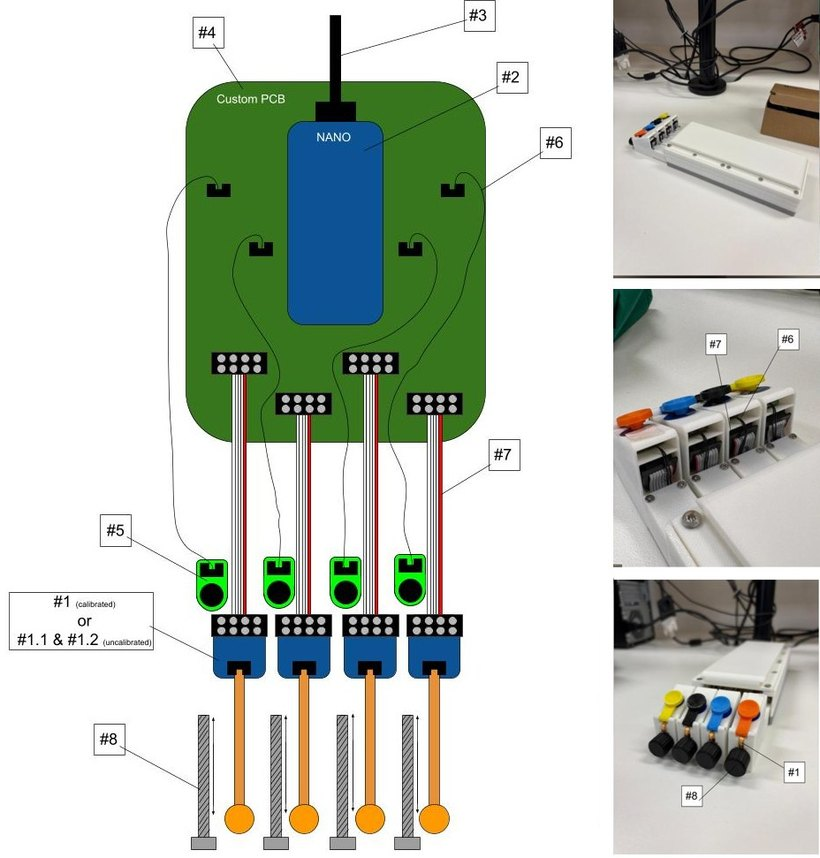

# arduino

<b>1</b> SingleTact pad and its board &middot; <b>2</b> Arduino Nano &middot; <b>3</b> USB cable &middot; <b>4</b> custom PCB &middot; <b>5</b> motor PCB <b>6</b> motor PCB connector &middot; <b>7</b> force sensor connector &middot; <b>8</b> threaded screw for finger adjustment Parts, wiring, pins and the printed chassis: <a href="../../hardware">hardware</a>

The code that runs on the hand device's Arduino Nano. The app ships both programs as ready-built hex files and flashes them itself, so nobody needs the Arduino IDE to set up a device.

| Folder | What it is |
| --- | --- |
| [`firmware_on_device/`](firmware_on_device) | The game firmware: reads the four pads at 200 Hz, sends them over USB and buzzes the motors on `STIM` commands. `lib/` holds Config (pins, addresses, the I2C read), Motor and Sensor |
| [`singletact_address_change/`](singletact_address_change) | A small sketch that moves one sensor to a new I2C address |

## What the firmware does

When the board powers up, or when the game opens its port (which resets a Nano), it waits half a second, buzzes each motor for 200 ms in turn as a self-test, prints `### Setup Complete ###` and starts streaming about 2.6 s after the reset. From then on:

- Every 5 ms it reads six bytes from each SingleTact over I2C (index 0x05, middle 0x06, ring 0x07, little 0x08) and prints one line, `FSR: a,b,c,d`, at 115200 baud. A failed read goes out as 0, which is why a loose lead and a dead pad look the same.
- `STIM:n` (n from 1 to 4) runs finger n's motor for 150 ms without holding up the sampling; another `STIM:n` before then restarts the 150 ms. `STOP` stops every motor. Nothing is sent back, so the game knows a command left the computer, not that a motor moved.

The protocol is the 2025 software's, kept so older sessions and tools still read. What can be changed lives in `firmware_on_device/lib/Config/Config.cpp`: the sample rate, each motor's strength (PWM 200 of 255, 240 on the little finger) and the buzz length. `Config.h` holds the pins and addresses, which are fixed by the board. After a change, rebuild the hex, flash it, and update the wiring table in [hardware](../../hardware), which `tests/test_hardware_docs.py` checks against these two files. The game expects 200 Hz (`fsr.sample_rate_hz`), and it holds a longer buzz by repeating `STIM` faster than the 150 ms runs out (`motor.pulse_interval_ms`).

## Flashing

Settings, Setup flashes both from `../assets/firmware` with the avrdude bundled in the app, so the Arduino IDE is not needed. `Finger Rehab --check-tools report.json` checks those tools by hand.

- **Flash firmware:** press, confirm, wait about ten seconds. The board restarts and buzzes all four motors. The line under Firmware names the hex the app carries.
- **Sensor address:** connect ONE sensor, enter the old and new address, confirm. The app flashes the address tool, moves the sensor, then puts the game firmware back; Scan lists what answers. Every SingleTact also answers 0x04 (SingleTact manual, section 2.3), so the app refuses a change from 0x04 with other sensors wired in. The device wants 0x05 index, 0x06 middle, 0x07 ring, 0x08 little.

When it goes wrong (the full avrdude output is in the app log):

- **No Arduino found:** plug it in. No port at all on Windows means the board's USB chip (CH340) has no driver yet: Setup, USB driver, Get the driver. macOS 10.14 and later need none.
- **Did not answer at 115200 or 57600:** the app tries both Nano bootloaders. Check the cable (some are charge only), unplug and replug, try again.
- **Could not open the port:** close the Arduino IDE, any serial monitor or another copy of the app.
- **"The GAME firmware is NOT on the board":** press Flash firmware.
- **This Mac needs Rosetta:** run `softwareupdate --install-rosetta` in Terminal once.

## Building by hand

`python3 builds/build_firmware.py` (from `app/`, needs PlatformIO) rebuilds both hexes into `assets/firmware/` with a checksum for each in `manifest.json`, and `python3 builds/fetch_avrdude.py` fetches the uploader; the build scripts and CI run both, and the app refuses a hex whose checksum doesn't match. To upload the game firmware from PlatformIO instead, set `board` in `firmware_on_device/platformio.ini` to the Nano's bootloader (`nanoatmega328new` for the newer one at 115200 baud, `nanoatmega328` for the older one at 57600) and `upload_port`. The address tool: `pio run -d arduino/singletact_address_change -e nanoatmega328new`.

The address tool talks at 115200 baud, one command per line:

| Send | Reply |
| --- | --- |
| (boot) | `### ADDR TOOL 1 ###` |
| `VERSION` | `ADDRTOOL 1` |
| `SCAN` | `FOUND: 0x04,0x05,0x06` (or `FOUND: none`) |
| `CHANGE:0x04,0x05` | `OK: 0x04 -> 0x05` (or `ERR: reason`) |
