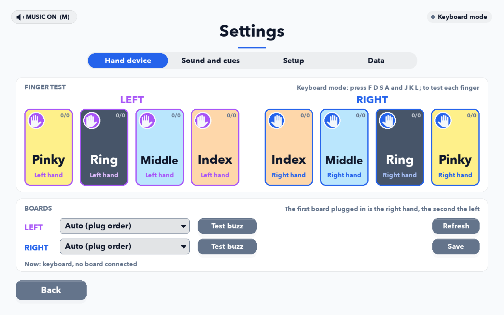

# config

Every number the game runs on is a setting here, with the reason for its value written beside it. Code reads one with `cfg.get("section.key", default)`, and the default in the code matches the YAML.

| File | What it is |
| --- | --- |
| [`default.yaml`](default.yaml) | Every setting, each one commented. The game reads this first |
| [`eeg_lab.yaml`](eeg_lab.yaml) | The lab's changes: markers on, the trigger box, and a Lab session that plays the SRT and leaves out Muscle Memory |
| [`calibration/`](calibration) | Saved hand calibrations, `current_<hand>.json` and a dated `history/` |
| [`pattern_sequence_template.yaml`](pattern_sequence_template.yaml) | A blank Muscle Memory sequence file, loaded from Settings, Data |

## The order the files are read

`finger_rehab/config.py` applies each file on top of the one before it, key by key, so a file only needs the keys it changes:

1. `default.yaml`.
2. `latency_profile.yaml`: this computer's measured sound and buzz delays, written by Settings, Setup, Audio delay. It may only set `latency.*` and the two rhythm offsets.
3. `user_settings.yaml`: whatever the Settings screen saved. Skipped when a `--config` file is given.
4. A `--config` file such as `eeg_lab.yaml`; a frozen exe automatically loads an `eeg_lab.yaml` found beside it. If that file is the app's own copy, a trigger box port picked in the game (`eeg_port.yaml`) is applied on top.
5. Command-line flags: `--eeg-port`, `--no-eeg-box`, `--windowed`, `--hand`, `--mode`, `--participant`, `--data-dir`.

## Where the per-computer files are kept

From source, here in `app/config/`. An installed app keeps them in a `config/` folder beside itself, or under `~/Finger Rehab Data` when it can't write there. The app writes `user_settings.yaml`, `eeg_port.yaml`, `latency_profile.yaml`, `srt_setups.json` (the Reaction card's saved set-ups) and any loaded Muscle Memory sequence, and git ignores them all, since they describe one machine.

<p align="center"></p>

## Changing a setting

- **On one computer:** the Settings screen, or the key written into `user_settings.yaml` as nested YAML. To turn on the chime after a correct press:

  ```yaml
  cue:
    sound_after: true
  ```

- **For every build:** edit `default.yaml`, say in the comment why the value is what it is, and run the tests.
- **For the lab:** `eeg_lab.yaml` holds only what the lab needs on top. A change to how a game looks, sounds or scores goes in `default.yaml`, so the lab plays the same game as every other build. Afterwards refresh the lab folder with `python3 scripts/check_lab_sync.py --fix`.

## What is in default.yaml

| Section | Covers |
| --- | --- |
| `session` | Where data goes, and the participant details saved with each block (affected side, dominant hand, impairment score, hand size) |
| `serial`, `autostart` | Boards: baud rate, ports pinned per hand, vendor IDs, plug-in watching |
| `firmware` | The hexes Settings flashes, avrdude, the bootloader speeds to try |
| `eeg` | Markers: on or off, the trigger box port and baud, pulse width, which feedback bytes go out |
| `fsr`, `quick_cal` | The pads and the press detector: newtons per count, the baseline, the press point, what counts a press, the resting-finger rules, the calibration steps |
| `instructions` | Saying each game's instruction aloud as its GET READY card opens (off) |
| `cue`, `motor` | What the player gets before and after a press, and how long a buzz lasts |
| `bilateral`, `game` | The hand, equal practice per finger, the countdowns, Test Mode, the keyboard maps |
| `scoring`, `metrics` | Points, reaction-time bands, wrong and idle press penalties, the force window |
| `adaptive`, `mirror`, `reaction`, `srt`, `pattern`, `chords`, `syllables`, `force_pilot`, `buzz_hunt`, `echo`, `rhythm` | One section per game, under its key |
| `latency`, `audio` | The stimulus delays, volumes, music folders |
| `ui`, `report`, `logging` | Screen size, theme and feedback wording; the per-block report; the log file |
| `protocol` | The timed sessions: each length's games, order, hand and shortened counts |
