# ui

Every screen the player or the researcher sees. [`screens.py`](screens.py) holds the login, the game menu, the lane games, Rhythm, the results and Settings; most other files hold one screen each.

<table>
<tr>
<td align="center" width="33%">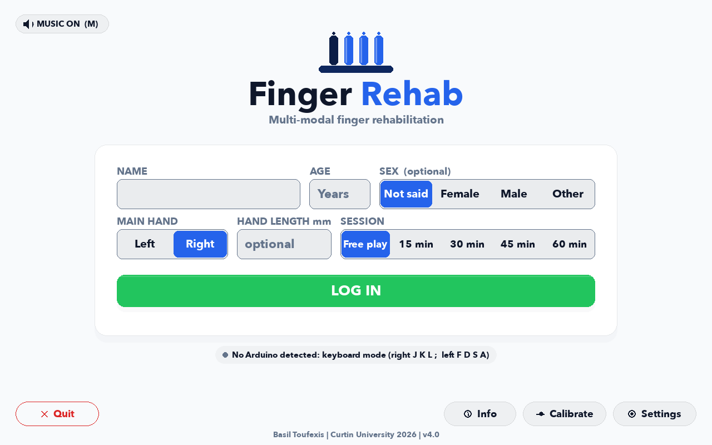 <b>Login</b> <code>screens.py</code> TitleScreen</td>
<td align="center" width="33%">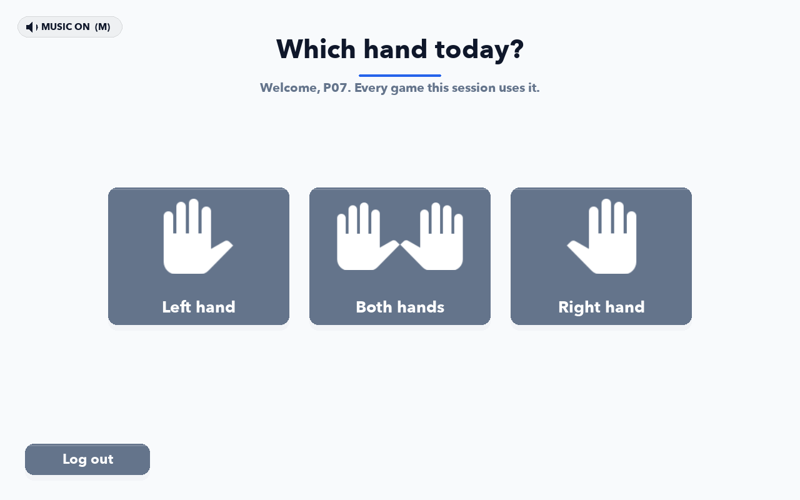 <b>Hand</b> <code>hand_choice_screen.py</code></td>
<td align="center" width="33%">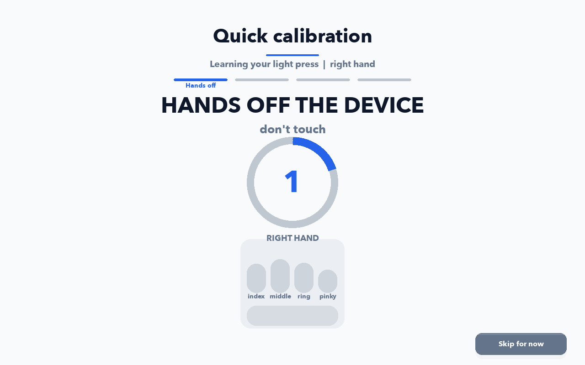 <b>Quick calibration</b> <code>quick_calibration_screen.py</code></td>
</tr>
<tr>
<td align="center" width="33%">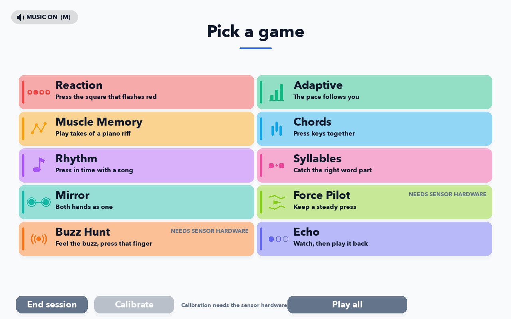 <b>Hub</b> <code>screens.py</code> ModeSelectScreen</td>
<td align="center" width="33%">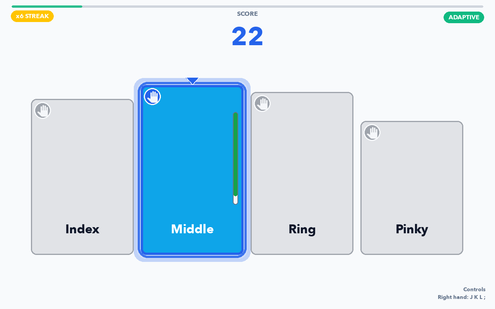 <b>Lane games</b> <code>screens.py</code> GameplayScreen</td>
<td align="center" width="33%">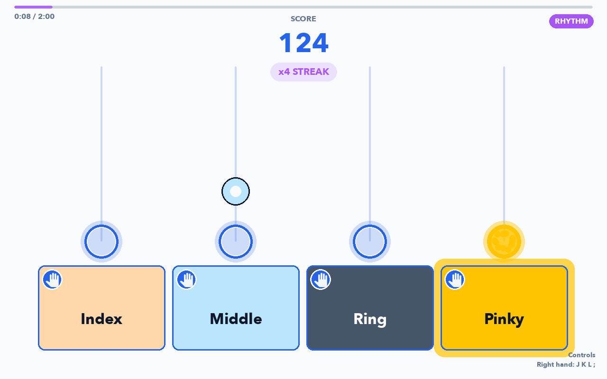 <b>Rhythm</b> <code>screens.py</code> RhythmScreen</td>
</tr>
<tr>
<td align="center" width="33%">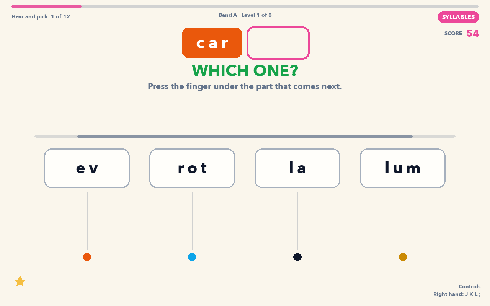 <b>Syllables</b> <code>syllables_screen.py</code></td>
<td align="center" width="33%">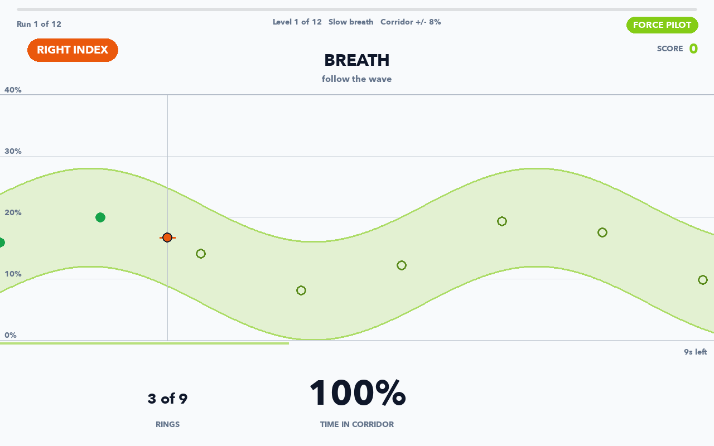 <b>Force Pilot</b> <code>force_pilot_screen.py</code></td>
<td align="center" width="33%">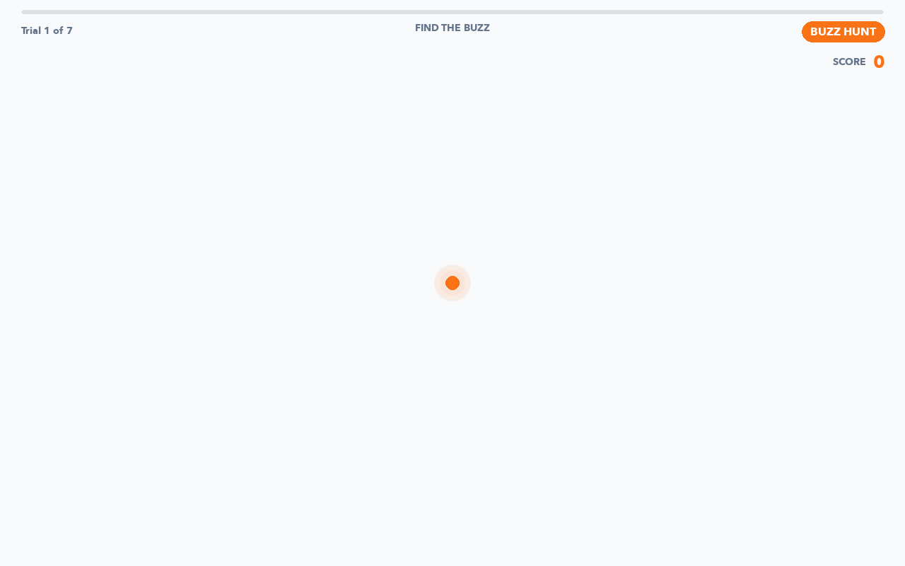 <b>Buzz Hunt</b> <code>buzz_hunt_screen.py</code></td>
</tr>
<tr>
<td align="center" width="33%">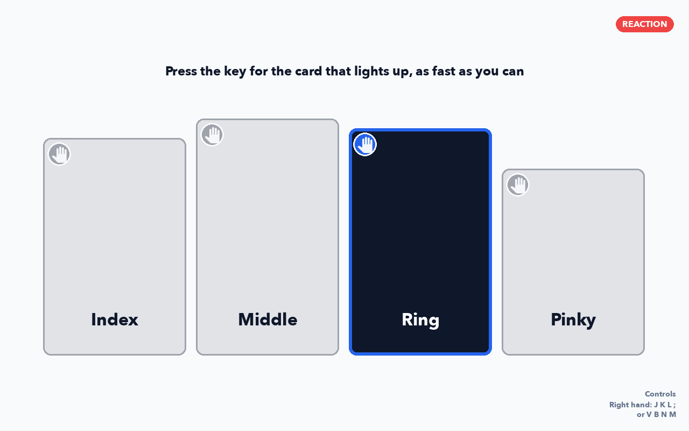 <b>Reaction</b> <code>srt_screen.py</code></td>
<td align="center" width="33%">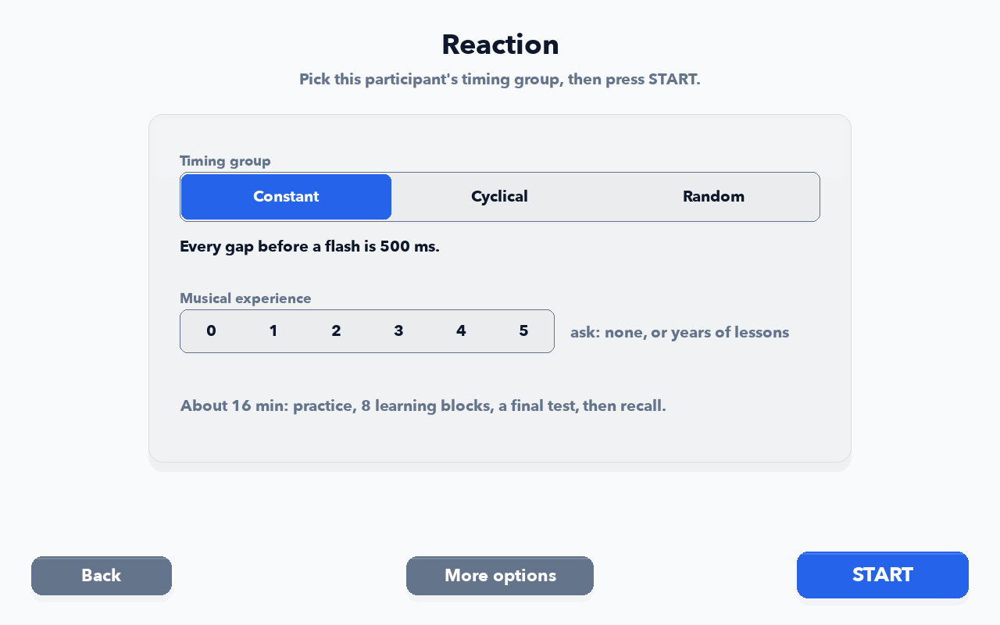 <b>Reaction setup</b> <code>srt_setup_screen.py</code></td>
<td align="center" width="33%">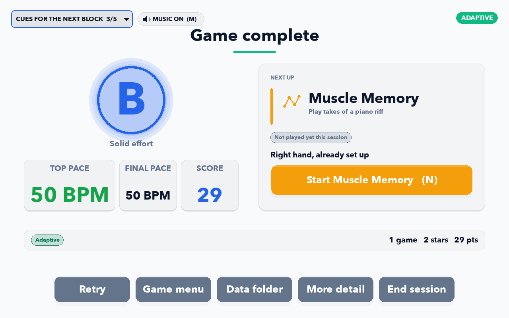 <b>Results</b> <code>screens.py</code> ResultsScreen</td>
</tr>
<tr>
<td align="center" width="33%">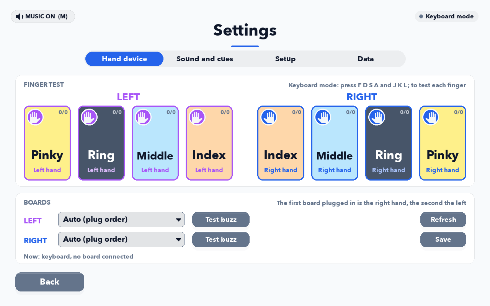 <b>Settings</b> <code>screens.py</code> DiagnosticsScreen</td>
<td align="center" width="33%">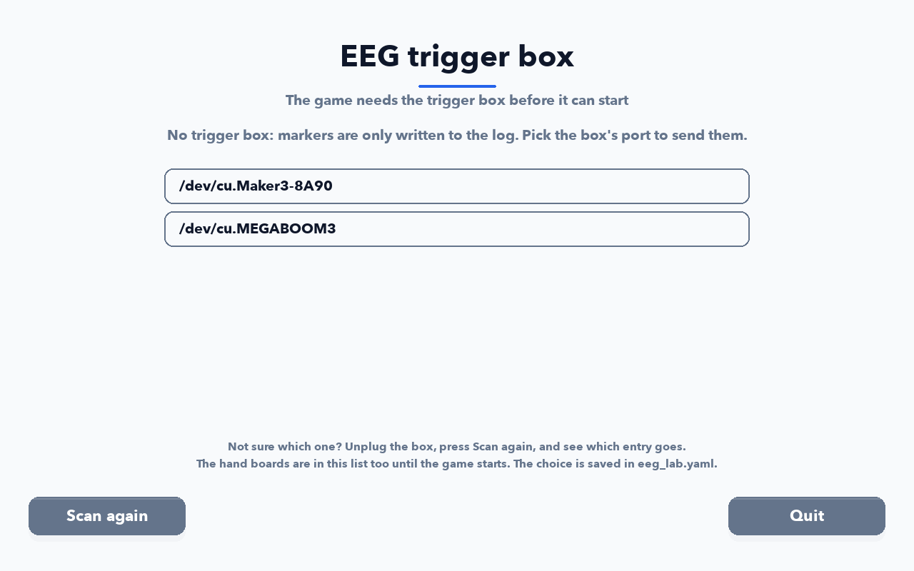 <b>EEG trigger box</b> <code>eeg_port_screen.py</code></td>
<td align="center" width="33%"></td>
</tr>
</table>

## How a screen works

Every screen subclasses `Screen` in `screens.py` and fills in three methods: `handle_event(e)`, `update(dt)` and `draw(surf)`. The engine builds each screen once at start-up (`GameEngine._build_screens()`, keyed by name) and shows one at a time by setting `engine.screen_obj`, usually through one of its `show_*` methods. Only the screen on show gets events and updates. A screen that runs a game passes the events and the frame on to the game (`engine.mode.handle_event`, `engine.mode.update`), so the game itself never draws.

Screens draw on a logical 1280 by 800 canvas (`ui.resolution` in the config) and SDL scales it to the window, so layouts are written in fixed pixels. `ui.font_scale` grows the text.

## The other files

| File | What it holds |
| --- | --- |
| [`theme.py`](theme.py) | The colour themes; `ui.theme` picks one (`clinical` ships) |
| [`widgets.py`](widgets.py) | Buttons, text, the lane strips, `Layout` and the font cache |
| [`feedback_bank.py`](feedback_bank.py) | Every word a player reads after a trial. The scoring labels (Perfect, Miss and the rest) are data for `trials.csv` and the EEG markers, never shown as they are |
| [`calibration_screen.py`](calibration_screen.py) | The longer guided calibration, from Calibrate on the login screen (the hub's Calibrate reruns the quick one) |
| [`firmware_dialog.py`](firmware_dialog.py) | The card behind Flash firmware and Sensor address |
| [`audio_delay_dialog.py`](audio_delay_dialog.py) | The card behind Audio delay |
| [`pattern_file_panel.py`](pattern_file_panel.py) | The Settings card for loading a Muscle Memory sequence file |

## Words on screen

Screens name things by what the player does. Research terms stay in the logs and the docs: the Muscle Memory card never says that anything repeats, because knowing the sequence is there changes the learning the game measures (the comment above `ModeSelectScreen.MODES` gives the sources). Feedback stays encouraging; a plain "Miss" in large type after every wrong press is what `feedback_bank.py` exists to prevent.

## Pictures and tests

`python3 scripts/make_screenshots.py` (from `app/`) renders every picture above from the real screens, played by a simulated player on a stepped clock, so they come out the same on any computer; `--only NAME` redoes one. `tests/test_screen_layout.py` checks what is on the login and Settings screens and that a click lands where its button is drawn, `tests/test_settings_header_fits.py` that nothing on Settings overlaps, and `tests/test_lane_screen_polish.py` that the script still makes every picture a README shows.
