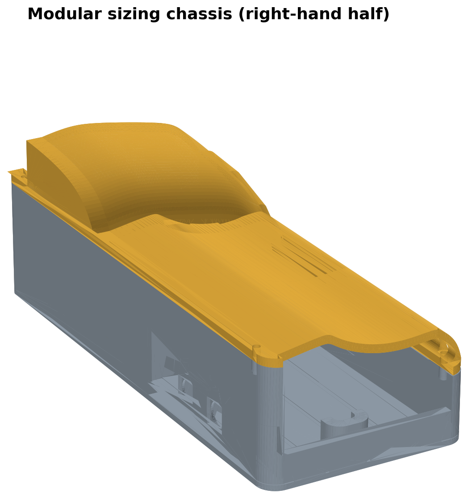
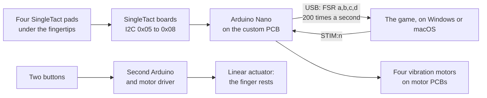

<h1 align="center">Hardware</h1>

The hand device: a printed chassis, four force pads, four vibration motors and an Arduino Nano. Everything needed to build one, and how it talks to the game.

 

## In this folder

| Path | What it is |
| --- | --- |
| [`cad/hand_device_v1.f3d`](cad/hand_device_v1.f3d) | The Fusion 360 model, Design v1.0. The part sizes and the mirrored left half come from it |
| [`cad/base.stl`](cad/base.stl), [`cad/top.stl`](cad/top.stl), [`cad/fingers.stl`](cad/fingers.stl) | The three printed parts, ready to slice. GitHub shows each one in 3D |
| [`linear_actuator/`](linear_actuator) | The sketch that moves the finger rests in and out |
| [`images/`](images) | The CAD render, the cross-section, both halves, and the parts and wiring diagram |

The game board's firmware is in [`app/arduino`](../app/arduino). The app flashes it from Settings, Setup, Flash firmware, so that board never needs the Arduino IDE.

## How it fits together

The game board does the sensing and the buzzing, and talks to nothing but the game, over USB. The finger rests are a separate circuit with its own Arduino and two buttons: the game never moves them, and they are set by hand for each person before the hand goes on.

## Building one

1. Print the base, the top shell and the finger rests (Printing and assembly, below).
2. Fit the four pads in the base. Wire their SingleTact boards to the game Nano's I2C pins and the four motor PCBs to its motor pins (Wiring, below).
3. Plug the Nano into a computer running the game. Give each pad its address with Settings, Setup, Sensor address, one pad plugged in at a time; the app flashes a small address tool for the job and puts the game firmware back after it. A board that has never run the game firmware gets it from Settings, Setup, Flash firmware.
4. Check the whole chain with `python3 app/scripts/test_device.py`. It passes or fails each item: the stream arriving near 200 Hz, every pad resting in a sane range and answering for the right finger, every motor felt on the right finger, and a normal press crossing the trigger.
5. Flash `linear_actuator.ino` to the second Nano with the Arduino IDE (the app only flashes the game board), then wire its driver and buttons.
6. In the game, the quick calibration at login sets each finger's press point from that person's own resting and light-press levels, so nothing on the device needs tuning per person beyond the finger rests.

## Parts

| Part | Qty | AUD each | Notes |
| --- | --- | --- | --- |
| SingleTact 8 mm 10 N pad, calibrated, with its electronics | 4 | 192 | From the 2025 project |
| *or* SingleTact 8 mm 10 N pad, uncalibrated | 4 | 53 | Bought for the sensor comparison. Needs the board below, which outlives a failed pad |
| SingleTact standard electronics (board and jumper wires) | 4 | 62 | Only with the uncalibrated pads |
| Arduino Nano | 2 | 15 to 48 | One reads the pads and drives the motors, one drives the actuator. Clones work |
| USB A to micro B cable | 1 | 17 | Jaycar |
| Custom PCB for the Nano | 1 | | From the 2025 project; its design files are not in this repo |
| Vibration motor on a motor PCB, with connector | 4 | | A 10 mm coin motor from the Curtin electronics team, 2026; part number not recorded |
| Force sensor connector | 4 | | One per pad |
| Threaded screw | 4 | | Fine adjustment of each finger rest |
| Linear actuator with motor driver | 1 | 45 | Two were bought, one for each hand |
| Neodymium magnet | 4 | 5 | Hold the top shell on |
| PLA and PETG filament | 2 spools | 30 | The chassis is PLA: about 370 cm3 of solid plastic, less with infill |

From the parts and wiring diagram ([`images/parts_and_wiring.jpg`](images/parts_and_wiring.jpg)) and the thesis cost table. The mirrored left half of the model, the uncalibrated pads and the second actuator are for a left-hand device; sittings on it moved to future work on 3 October 2026.

## Wiring

The game board, an Arduino Nano on the custom PCB:

| Nano pin | Goes to |
| --- | --- |
| A4 (SDA), A5 (SCL), 5V, GND | The four SingleTact boards, on one I2C bus |
| D11 | Index finger motor |
| D10 | Middle finger motor |
| D9 | Ring finger motor |
| D6 | Little finger motor |
| USB | The computer |

- **Pads:** index 0x05, middle 0x06, ring 0x07, little 0x08. A new pad arrives on a factory address; move it with Settings, Setup, Sensor address, with only that pad plugged in. Every SingleTact also answers 0x04, which is why the app refuses to change 0x04 while other pads are wired in: the write would land on all of them.
- **Readings:** the board reads 6 bytes from each pad 200 times a second and sends `FSR: a,b,c,d` over USB at 115200 baud. The manual quotes up to 120 Hz per pad, but recorded sessions show a new value on nearly every read; values repeat when force changes by less than one step. A failed read is sent as 0.
- **Buzz:** `STIM:n` from the game drives motor n (1 to 4) for 150 ms at PWM 200 of 255 (240 on the little finger). Nothing comes back, so the game knows a command was sent, not that a motor moved.

The actuator board, a second Arduino running [`linear_actuator.ino`](linear_actuator/linear_actuator.ino):

| Pin | Goes to |
| --- | --- |
| D8, D9 | Driver IN1 and IN2: the direction |
| D10 | Driver ENA: the speed, PWM 255 |
| D2 | Extend button, to GND |
| D3 | Retract button, to GND |

Hold a button to move the rests. Let go, or press both, and it stops. The buttons need no resistors: the sketch turns on the Nano's own pull-ups.

## Printing and assembly

| Part | File | Size, mm |
| --- | --- | --- |
| Base | [`base.stl`](cad/base.stl) | 98 x 231 x 56 |
| Top shell | [`top.stl`](cad/top.stl) | 98 x 231 x 52 |
| Finger rests | [`fingers.stl`](cad/fingers.stl) | 78 x 130 x 53 |

- Print in PLA. The base and top are 231 mm long, so check the bed first.
- The base holds the actuator and the four pads. The top shell sits over it on the four magnets and can be swapped for other finger-groove layouts.
- The actuator moves the finger rests in and out for hand length, over the 5th to 95th percentile of the ANSUR II survey; the screws fine-tune each finger.
- Fingertips meet the pads with about 2 mm of clearance, and the forearm rests at about 30 degrees of pronation ([cross-section](images/chassis_section.png), [both halves](images/chassis_left_right.png)).
- **Safety:** the actuator can pinch. Set the finger rests before the hand goes on and never move them with a hand in place; no stall shut-off is fitted yet.

## Changing the hardware

- Pins and pad addresses live in `app/arduino/firmware_on_device/lib/Config/Config.h`; the sample rate, each motor's strength and the buzz length in `Config.cpp` beside it. After a change, rebuild and flash the firmware ([app/arduino](../app/arduino)) and update the tables here: `app/tests/test_hardware_docs.py` reads the pins, addresses, rate and buzz length out of the firmware and the actuator sketch, and fails when this page disagrees.
- The newton figures assume 10 N pads read over 512 counts, 51.2 counts to the newton. The game converts with `fsr.force_calibration_n_per_count` in `app/config/default.yaml`, and the notebook falls back on `fsr.sensor_rating_n` over `fsr.counts_full_scale`, so a pad with another rating needs all three changed to match.
- The game reads four pads per board and up to two boards, one per hand.

## Two boards: the timing bench

Before any Mirror gap or lead is reported, measure the rig with no hands in it: press each finger pair's two pads together with one rigid bar about 100 times, boards swapped between ports and between hands, and note the mean and SD of the logged gap. Measure each board's motor lag the way `latency.buzzer_ms` was measured. Each board's samples carry their own stamp, and raw.csv names the board of every sample row.

## What a next build could fix

- The actuator has no stall shut-off, so it can pinch a finger.
- Motor strength is fixed when the firmware is compiled; the game can make a buzz longer but not stronger.
- The custom PCB's design files and the motor's part number were not kept with the project.
- The uncalibrated pads have not been benched (`app/scripts/pad_bench.py --characterise`); the calibrated set's newtons rest on the maker's calibration.

## Not part of this build

The EEG lab's marker box is the lab's own Arduino on COM10: it puts each byte the game sends onto the EEG trigger lines. See [`EEG_Lab`](../EEG_Lab).

The earlier sensor-address walkthrough and the force-sensor bench analysis are in [`archive/old_rayyan_stuff`](../archive/old_rayyan_stuff); the SingleTact user manual (singletact.com) shows the pad wiring.
