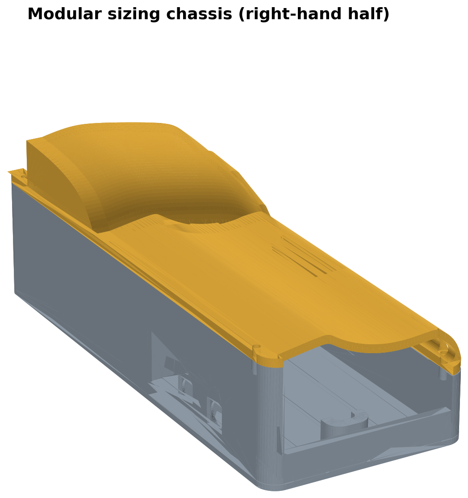
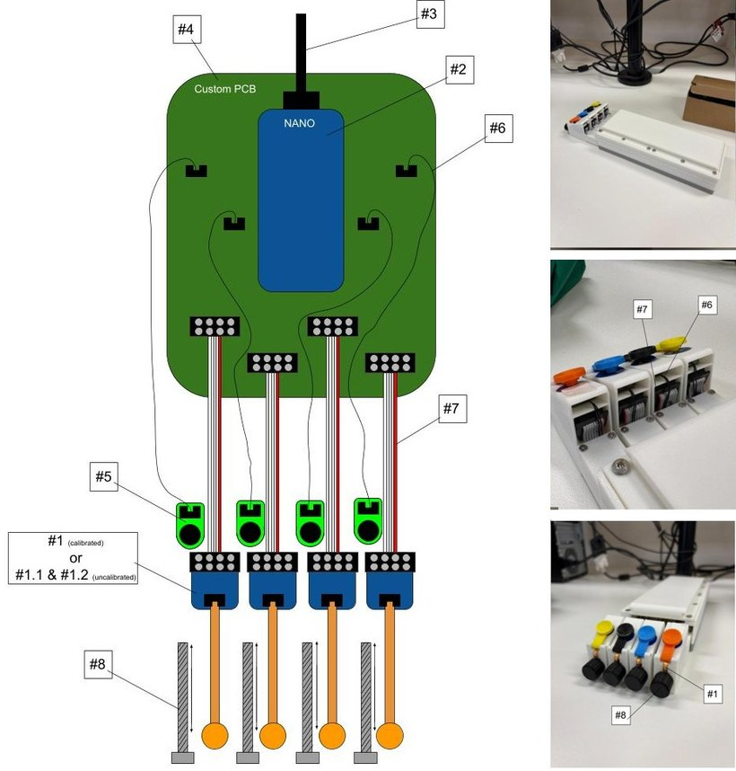
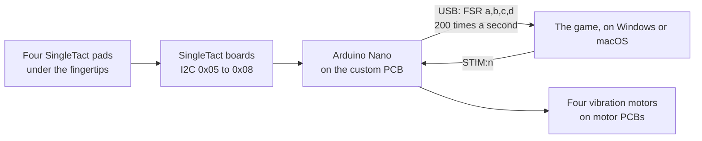

<h1 align="center">Hardware</h1>

The hand device: a printed chassis, four force pads, four vibration motors and an Arduino Nano. Everything needed to build one, and how it talks to the game.

 

## In this folder

| Path | What it is |
| --- | --- |
| [`cad/hand_device_v1.f3d`](cad/hand_device_v1.f3d) | The Fusion 360 model, Design v1.0, with the mirrored left half |
| [`cad/base.stl`](cad/base.stl), [`cad/top.stl`](cad/top.stl), [`cad/fingers.stl`](cad/fingers.stl) | The three printed parts, ready to slice; GitHub shows each in 3D |
| [`linear_actuator/`](linear_actuator) | A sketch for powered finger rests, not fitted to this build |
| [`images/`](images) | The CAD render, the cross-section, both halves, and the parts and wiring diagram |

The board's firmware is in [`app/arduino`](../app/arduino); the app flashes it from Settings, Setup, Flash firmware, so it never needs the Arduino IDE.

## How it fits together

The board does the sensing and the buzzing, and talks to nothing but the game. The finger rests sit on threaded rods, one per finger, and are set by hand for each person before the hand goes on.

## Building one

1. Print the base, the top shell and the finger rests (below).
2. Fit the four pads in the base, then wire their SingleTact boards and the four motor PCBs to the Nano (Wiring, below).
3. Plug the Nano into a computer running the game. Give each pad its address with Settings, Setup, Sensor address, one pad plugged in at a time; a new board gets the game firmware from Settings, Setup, Flash firmware.
4. Run `python3 app/scripts/test_device.py`. It passes or fails each part of the chain: the stream near 200 Hz, each pad resting in range and answering for its own finger, each motor felt on its own finger, and a normal press crossing the trigger.
5. Calibrate at login. The game sets each finger's press point from that person's own resting and light-press levels, so the rods are the only thing set per person.

## Parts

| Part | Qty | AUD each | Notes |
| --- | --- | --- | --- |
| SingleTact 8 mm 10 N pad, calibrated, with its electronics | 4 | 192 | From the 2025 project |
| *or* SingleTact 8 mm 10 N pad, uncalibrated | 4 | 53 | Bought for the sensor comparison. Needs the board below, which outlives a failed pad |
| SingleTact standard electronics (board and jumper wires) | 4 | 62 | Only with the uncalibrated pads |
| Arduino Nano | 1 | 15 to 48 | Reads the pads and drives the motors. Clones work |
| USB A to micro B cable | 1 | 17 | Jaycar |
| Custom PCB for the Nano | 1 | | Made for this build, with new connectors; its design files are not in this repo |
| Vibration motor on a motor PCB, with connector | 4 | | A 10 mm coin motor from the Curtin electronics team, 2026; part number not recorded |
| Force sensor connector | 4 | | One per pad |
| Threaded rod | 4 | | Sets each finger rest by hand |
| Neodymium magnet | 4 | 5 | Hold the top shell on |
| PLA and PETG filament | 2 spools | 30 | The chassis is PLA: about 370 cm3 of solid plastic, less with infill |

From the parts and wiring diagram ([`images/parts_and_wiring.jpg`](images/parts_and_wiring.jpg)) and the thesis cost table. The model's mirrored left half and the uncalibrated pads are for a left-hand device; sittings on it moved to future work on 3 October 2026.

## Wiring

| Nano pin | Goes to |
| --- | --- |
| A4 (SDA), A5 (SCL), 5V, GND | The four SingleTact boards, on one I2C bus |
| D11 | Index finger motor |
| D10 | Middle finger motor |
| D9 | Ring finger motor |
| D6 | Little finger motor |
| USB | The computer |

- **Pads:** index 0x05, middle 0x06, ring 0x07, little 0x08. A new pad comes on a factory address; move it with Settings, Setup, Sensor address, with only that pad plugged in. Every SingleTact also answers 0x04, so the app won't change 0x04 while other pads are wired in: the write would land on all of them.
- **Readings:** the board reads 6 bytes from each pad 200 times a second and sends `FSR: a,b,c,d` over USB at 115200 baud. The manual quotes up to 120 Hz per pad, but recorded sessions show a new value on nearly every read. A failed read is sent as 0.
- **Buzz:** `STIM:n` from the game drives motor n (1 to 4) for 150 ms at PWM 200 of 255 (240 on the little finger). Nothing comes back, so the game knows a command was sent, not that a motor moved.

## Printing and assembly

| Part | File | Size, mm |
| --- | --- | --- |
| Base | [`base.stl`](cad/base.stl) | 98 x 231 x 56 |
| Top shell | [`top.stl`](cad/top.stl) | 98 x 231 x 52 |
| Finger rests | [`fingers.stl`](cad/fingers.stl) | 78 x 130 x 53 |

- Print in PLA. The base and top are 231 mm long, so check the bed first.
- The base holds the four pads. The top shell sits over it on the four magnets and can be swapped for other finger-groove layouts.
- The chassis is sized for hand lengths from the 5th to the 95th percentile of the ANSUR II survey.
- Fingertips meet the pads with about 2 mm of clearance, and the forearm rests at about 30 degrees of pronation ([cross-section](images/chassis_section.png), [both halves](images/chassis_left_right.png)).

## Powered finger rests (not fitted)

A linear actuator was designed to move the finger rests, run by a second Arduino with [`linear_actuator.ino`](linear_actuator/linear_actuator.ino), a motor driver and two buttons. This build sets the rests on threaded rods instead, but the sketch and its wiring are kept for a build that brings it back:

| Pin | Goes to |
| --- | --- |
| D8, D9 | Driver IN1 and IN2: the direction |
| D10 | Driver ENA: the speed, PWM 255 |
| D2 | Extend button, to GND |
| D3 | Retract button, to GND |

Hold a button to move the rests; let go, or press both, and it stops. The buttons need no resistors, as the sketch turns on the Nano's own pull-ups. It has no stall shut-off, so it can pinch: set the rests before the hand goes on.

## Changing the hardware

- Pins and pad addresses live in `app/arduino/firmware_on_device/lib/Config/Config.h`; the sample rate, motor strength and buzz length in `Config.cpp` beside it. After a change, rebuild and flash the firmware ([app/arduino](../app/arduino)) and update the tables here: `app/tests/test_hardware_docs.py` reads them out of the firmware and the actuator sketch and fails when this page disagrees.
- The newton figures assume 10 N pads read over 512 counts, 51.2 counts to the newton. The game converts with `fsr.force_calibration_n_per_count` in `app/config/default.yaml` and the notebook falls back on `fsr.sensor_rating_n` over `fsr.counts_full_scale`, so a pad with another rating needs all three changed.
- The game reads four pads per board and up to two boards, one per hand.

## Two boards: the timing bench

Before any Mirror gap or lead is reported, measure the rig with no hands in it: press each finger pair's two pads together with one rigid bar about 100 times, boards swapped between ports and between hands, and note the mean and SD of the logged gap. Measure each board's motor lag the way `latency.buzzer_ms` was measured. Each board's samples carry their own stamp, and raw.csv names the board of every sample row.

## What a next build could fix

- Motor strength is fixed when the firmware is compiled; the game can make a buzz longer but not stronger.
- The custom PCB's design files and the motor's part number were not kept with the project.
- The uncalibrated pads have not been benched (`app/scripts/pad_bench.py --characterise`); the calibrated set's newtons rest on the maker's calibration.
- Powered finger rests would need a stall shut-off before going back in.

## Not part of this build

The EEG lab's marker box is the lab's own Arduino on COM10: it puts each byte the game sends onto the EEG trigger lines. See [`EEG_Lab`](../EEG_Lab). The earlier sensor-address walkthrough and the force-sensor bench analysis are in [`archive/old_rayyan_stuff`](../archive/old_rayyan_stuff); the SingleTact user manual (singletact.com) shows the pad wiring.
